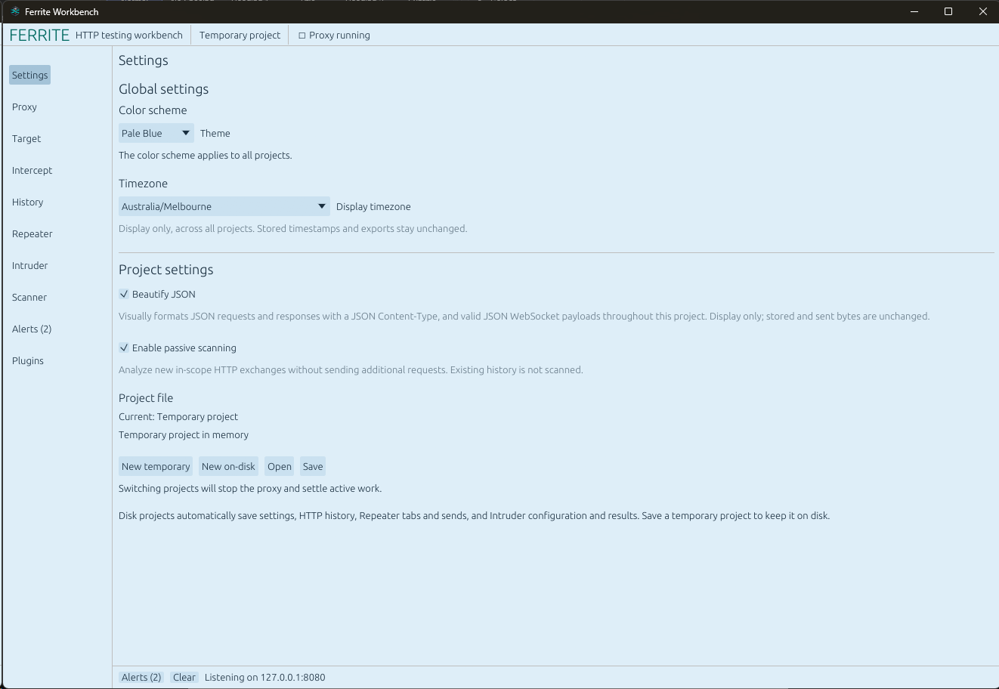
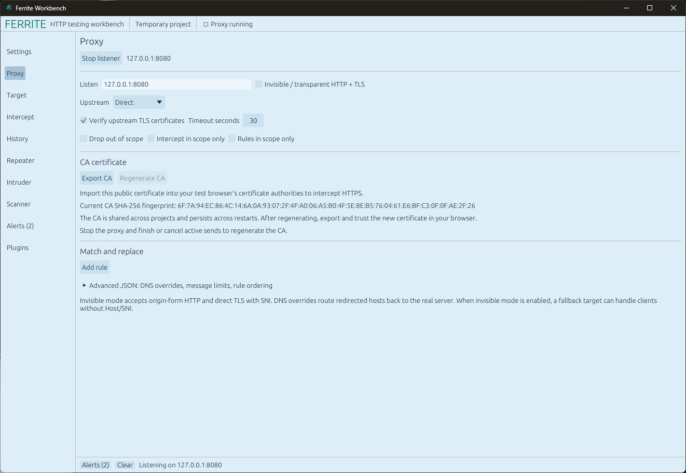
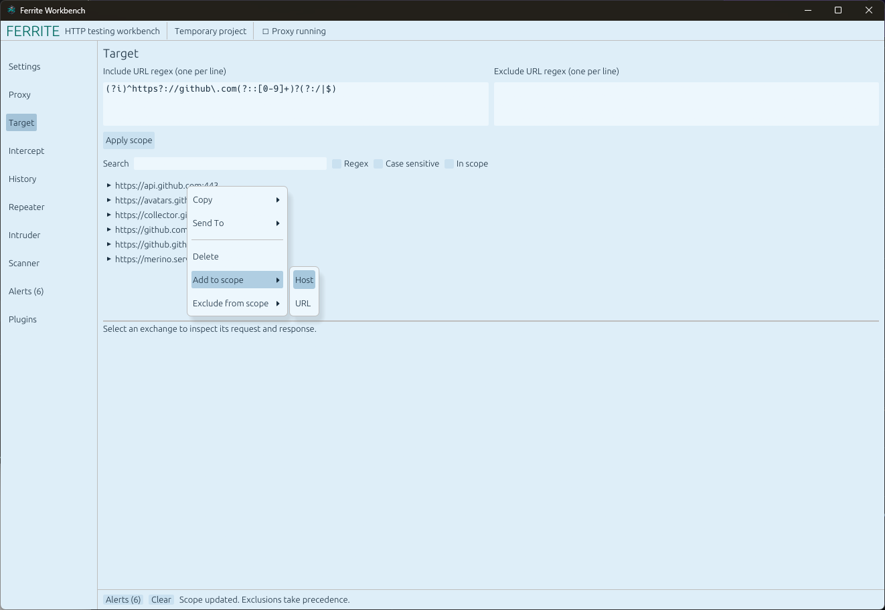
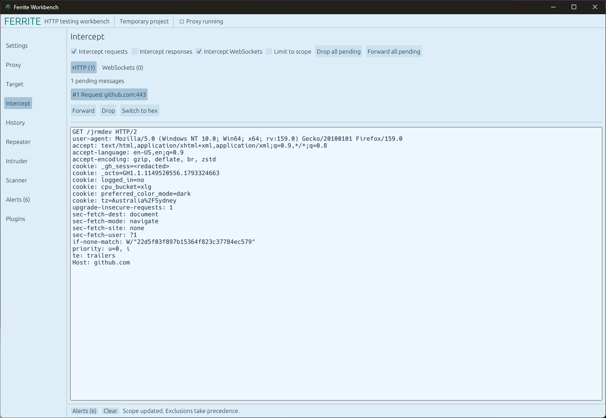
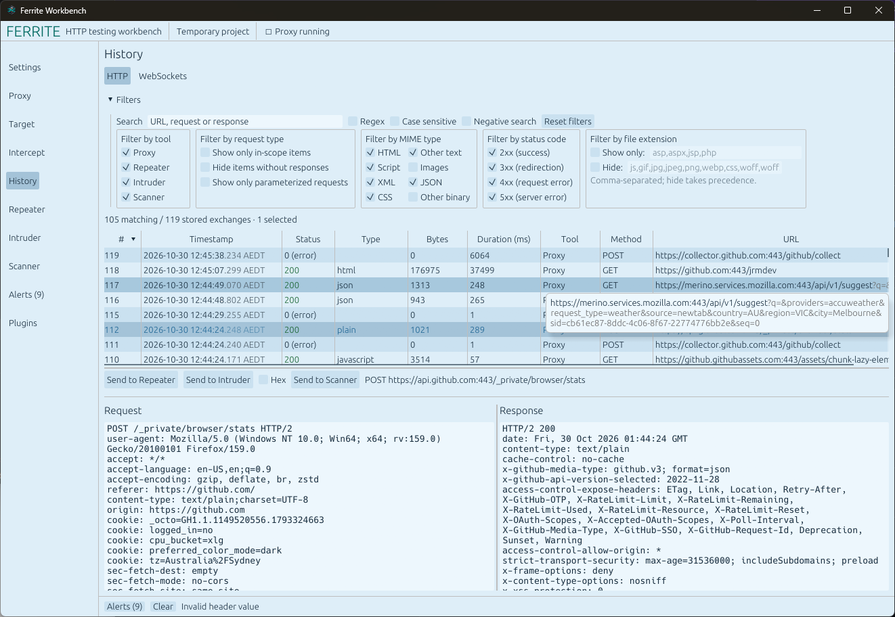
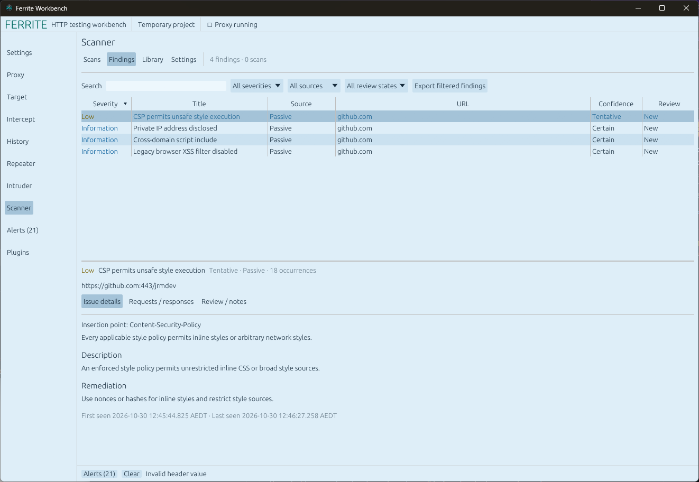
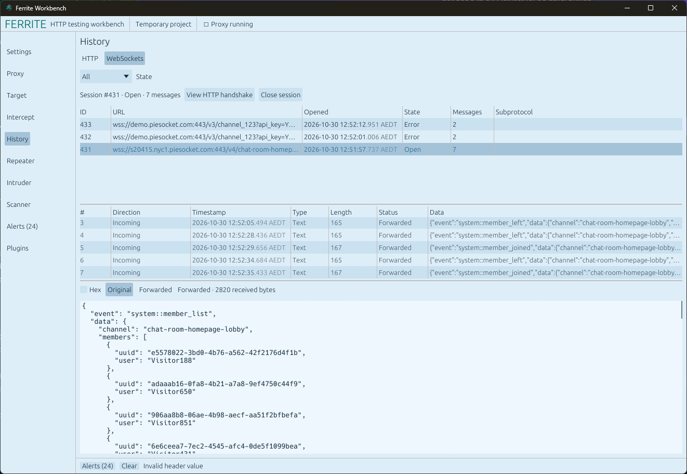

# Ferrite Workbench

Ferrite is a free, native desktop workbench for HTTP security testing. Inspired by Burp Proxy, it is an independent implementation written from scratch in Rust, with its own interface and project format.

Built for speed, Ferrite uses a native UI and asynchronous networking. A small memory footprint (5x - 10x smaller memory usage compared to Burp Proxy).

## Screenshots

**Settings**



**Proxy**



**Target**



**Intercept**



**HTTP history**



**Scanner findings**



**WebSocket history**



## Tools

- **Proxy** — Capture HTTP and HTTPS traffic through a local listener. Configure upstream HTTP or SOCKS5 proxies, TLS verification, match-and-replace rules, and the proxy CA certificate.
- **Target** — Browse captured hosts and paths in a site map and manage which URLs are in scope.
- **Intercept** — Pause, inspect, edit, forward, or drop HTTP requests and responses and WebSocket messages.
- **History** — Search, filter, sort, inspect, and export captured exchanges. A WebSockets view lists sessions and their messages.
- **Repeater** — Edit and resend requests in named tabs, inspect responses, and navigate previous sends.
- **Intruder** — Run payload-based attacks using Sniper, Battering Ram, Pitchfork, and Cluster Bomb modes, with configurable concurrency and pacing.
- **Scanner** — Run passive checks on new in-scope traffic and active checks on selected requests. Review findings and evidence, manage checks in the Library, and export reports.
- **Alerts** — Review connection errors, failed exchanges, and application activity.
- **Settings** — Manage projects, appearance, display timezone, and JSON formatting.
- **Plugins** — Reserved for future extension support.

## Getting started

Install Rust 1.96 or newer, then start Ferrite:

```sh
cargo run --release -- --project assessment.ferrite
```

1. Open **Proxy** and select **Start listener**.
2. Configure your browser to use `127.0.0.1:8080` as its HTTP and HTTPS proxy.
3. For HTTPS inspection, export the public CA certificate from **Proxy** and trust it in your test browser.
4. Add your target to scope, then inspect traffic in **History** or send requests to **Repeater**, **Intruder**, or **Scanner**.

Passive scanning is enabled by default for new projects and analyzes new in-scope exchanges without sending additional requests. Active scans reuse captured credentials; intrusive checks require explicit enablement. Scanner does not automatically crawl, log in, or execute a browser.

Ferrite also supports headless proxying:

```sh
cargo run --release --no-default-features -- --headless --project assessment.ferrite --listen 127.0.0.1:8080 --export-ca assessment-ca.pem
```

Press Ctrl-C to stop the listener. Run `ferrite --help` for more options.

## Projects and traffic

Projects store captured traffic, tool configuration, findings, and results in a `.ferrite` file. Temporary projects can be saved to disk from **Settings**. Project files can contain credentials and other sensitive traffic.

Scope uses URL regular expressions; an empty include list matches nothing. Captured traffic is not blocked by scope unless **Drop out of scope** is enabled. History filters change the displayed rows without deleting captured traffic.

Ferrite supports HTTP/1.1, HTTP/2, HTTPS interception, and WebSocket capture. Response previews decode supported content encodings, while JSON beautification formats the display without changing the stored or transmitted bytes.

## Build and test

```sh
cargo fmt --check
cargo clippy --all-targets -- -D warnings
cargo test --all-targets
cargo test --no-default-features --all-targets
cargo build --release --locked
```

The project uses egui for the desktop UI, Tokio for networking, redb for project storage, and Rustls with RustCrypto for TLS. The RustCrypto TLS provider is experimental. See [architecture](docs/ARCHITECTURE.md) for implementation details.

## License

MIT. See [LICENSE](LICENSE).
