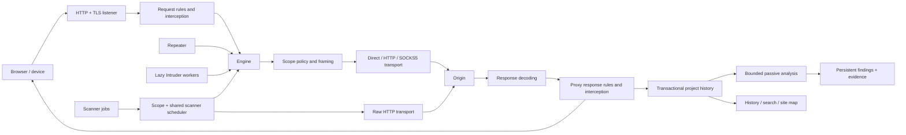

# Implementation

The GUI and headless CLI share a single engine. Proxy connections, Repeater sends, and Intruder workers use the same routing, HTTP framing, upstream proxy, TLS, scope policy, and project recorder.

The diagram describes Ferrite's implementation, not recovered Burp internals.

## Module boundaries

| Module | Responsibility |
| --- | --- |
| model | Versioned serializable settings, scope, destination, exchanges, workspace state |
| project | redb transactions, metadata and exchange tables, temporary project storage, file locking, save-as, portable archive import/export, transactional deletion |
| http | Header parsing, bounded HTTP/1 framing, chunk decoding, editor conversion, content decoding |
| http2 | ALPN-selected/prior-knowledge HTTP/2 framing, pseudo-header translation, bounded body buffering and flow control |
| tls | Pure Rust P-256 certificate signing, persistent project CA, bounded hostname certificate cache |
| transport | Direct TCP, conventional HTTP upstream forwarding / CONNECT, SOCKS5, outbound TLS and ALPN negotiation |
| engine | Listener lifecycle, request/response pipeline, interception queue, per-request policy, history recording |
| intruder | Marker validation, checked attack cardinality, lazy assignment, bounded workers, shared pacing, cancellation |
| scanner | HTTP check registry, byte-preserving insertion points, passive analysis, active confirmation, shared resource scheduling, checkpoints, findings/evidence, and reports |
| history | Serializable history filters, MIME/status classification, parameter and extension matching, compiled search |
| history_export | Versioned selected-exchange JSON, streaming base64 messages, exchange metadata, private create-new files |
| app | Native UI, separate Intercept/History/Alerts pages, listener controls in Proxy, compact data views and asynchronous work dispatch |
| main | CLI, public CA export, native/headless startup |

## Message pipeline

Incoming bodies stay byte buffers. HTTP framing rejects conflicting lengths and Transfer-Encoding/Content-Length ambiguity, decodes chunked bodies, and bounds headers, body, and chunk metadata. Expect: 100-continue receives an interim response before body reads.

Proxy request replacement runs before the interactive queue. Content-Length and hop headers are normalized before sending. Repeater and Intruder deliberately do not inherit Proxy replacement rules. Scope blocking applies to all three tools. Each request uses a settings snapshot; bind/invisible mode changes require a listener restart.

Outbound TLS authenticates against bundled WebPKI roots by default. An explicit per-project setting allows interception of origins with untrusted certificates. Gzip/deflate responses are decoded before inspection and Proxy response replacement. Informational responses are consumed; protocol upgrades return an error. HEAD and 304 preserve entity-length metadata without consuming a body.

Queue decisions use one-shot channels. Disabling a stage releases its pending messages; Drop rejects them. The interception gate evaluates the current scope policy against the effective request URL at both stages. Enabling the scope limit or changing scope automatically forwards queued messages that are now out of scope. A guard removes entries when a connection task is cancelled. Stopping a listener aborts its connection tasks and clears its interception queue. The listener caps active connections at 256. Incoming HTTP/2 connections permit up to 128 concurrent streams and keep driving the connection while stream tasks await bodies, interception, or origins. TLS negotiates h2/http/1.1 independently on each leg; HTTP/1 responses are translated when crossing protocols. Cleartext prior knowledge is explicit for outbound tools; cleartext Proxy origins use HTTP/1.1. HTTP/2 body writes honor stream capacity in 16 KiB chunks, reads release capacity, and connection driver tasks are aborted when cancelled. The queue caps pending entries at 256. Message size and timeouts are configurable; human interception wait is excluded from upstream network timeout.

Intruder does not allocate its request Cartesian product. An index maps to a payload tuple, and at most the configured worker count is active. A shared start clock provides spacing. Cancellation aborts active workers and stops generation.

## Storage and recovery

The UI drains connection diagnostics from the engine into a bounded 500-entry Alerts log and adds failed exchanges and application notifications. Each entry has a timestamp, severity, and source; repeated errors remain separate events. Switching projects clears the session log. Listener controls live in Proxy and apply edited settings before starting. Compact row styling is scoped to History filters, the history table, and the Target tree.

History selection tracks exchange IDs and an anchor rather than row indexes. Ctrl/Cmd-click toggles rows; Shift-click ranges use the current sorted/filtered order. Context-click preserves an existing multi-selection. Exports snapshot selected exchanges when the action is invoked, so subsequent capture activity cannot change the export. Message bytes are serialized as standard base64 without UTF-8 conversion; these exports omit project settings and CA keys. Host scope actions generate anchored exact-host regexes covering both HTTP schemes and arbitrary ports, including IPv6 literals. URL scope actions escape and anchor the complete URL. Intercepted responses retain their effective URL and originating request for editor actions; Repeater request actions snapshot current edits. The public CA exporter is an inline section under Proxy, before Match and replace. Proxy is the initial page and Target host/path nodes default to collapsed.

History display filters live in the workspace with serde defaults for older projects. Filtering compiles search once per view update and operates on stored exchanges; it never changes recording or networking. History and Target/Intruder search controls have separate state.

A project has `metadata` and `exchanges` tables. Metadata includes schema 1, serialized workspace/settings, and a PKCS#8 project CA signing key. Exchanges contain the normalized request and response bytes, service, canonical URL, tool, timestamp, duration, status, and error.

A completed exchange commits before its completion counter changes. Failed upstream requests are also recorded. A process interrupted during an active exchange can leave an ID gap and no final row for that exchange. Pending interception decisions are not resumed after restart, and opening a project never starts network tasks automatically.

Save As refuses an existing file and copies completed history and metadata to a new database. Portable versioned JSON archives carry the workspace, all exchange bytes, IDs, Repeater references, and the CA key. Imports validate format/schema, settings, duplicate IDs, and history references before opening a separate memory project. Archive exports refuse existing destinations and create files with mode 0600 on Unix. Deletions remove exchanges and Repeater references in one transaction. Project formats are independent of Burp. Full-history UI caching is a known v1 scaling constraint; the next storage iteration should expose paged summaries and fetch message bodies on selection.

## Portability

Application and cryptographic implementations are Rust. OS socket, filesystem, windowing, and OpenGL APIs remain platform dependencies. redb avoids SQLite/C bundling. Rustls defaults are disabled, and rcgen uses a custom RustCrypto signer; no ring/AWS-LC/OpenSSL provider is enabled. Native rendering uses eframe/glow instead of an embedded web frontend.

The Linux release and local runtime are verified in this workspace. Windows GNU x64 and macOS ARM64 target checks cover the GUI, backend, CLI, and test targets. Linking and native execution on those platforms require the CI matrix.

History viewport state records the top visible exchange ID, fractional row offset, sort order, and stripe phase. New traffic resolves that anchor in the sorted rows instead of shifting the viewed exchanges; an offset at zero follows newest entries. Sort changes reset to the top. HTTP editors constrain their split geometry to the visible clip rectangle and truncate long metadata. Read-only messages display their bodies directly using UTF-8 with replacement for invalid sequences; full-message hex is an explicit toggle. Captured bytes are unaffected by rendering. Stripes preserve their phase relative to the anchored exchange when an odd number of rows arrives. Backgrounds and hit testing use current cell geometry, since egui Ui responses can expose prior-frame or empty rectangles. Row interactions and label IDs follow exchange IDs rather than row indexes, keeping hover, selection, and tooltips stable during captures. Regression tests compare text and background paint on every immediate frame across successive arrivals with the pointer inside and outside the table; native checks sample frames while traffic arrives. Only the built-in truncated-label tooltip is used for table cells; editable hex messages provide a readable header preview.

Response previews use bounded pure Rust Brotli, gzip, zlib/raw deflate and Zstandard decoders, reversing stacked Content-Encoding fields and supporting concatenated gzip/Zstandard frames. Invalid/unsupported/over-limit previews retain the raw message. Saved views retain original headers and cache one rendered response by immutable exchange ID, hex mode and configured message limit; project switches clear the cache. Intercept loads a normalized decoded copy; forwarding an unchanged preview restores the original compressed Message, while explicit edits forward the edited decoded Message through normal framing. Networking and project records retain their existing behavior.

## Scanner integration

Completed exchanges enqueue passive analysis when the project checkbox is enabled and the effective URL is in scope. Queue count, retained bytes, decoded body size, and candidate evidence are bounded. Passive detectors receive immutable messages without a transport. Scanner jobs retain check/profile snapshots while sharing live concurrency, pacing, throttling and scope controls. Normal probes reuse transport routing; raw probes use a separate HTTP/1 connection and preserve framing bytes, including through HTTP proxy CONNECT tunnels. A live scope guard runs after connection establishment and before sending HTTP data.

Separate scanner job and finding tables persist checkpoints and immutable evidence. Existing workspace schemas receive default scanner settings. Reopening interrupts unfinished work; checkpoint versions prevent replay against changed probe generators. Saving a live temporary project retains running scanner state. Findings survive history deletion and preserve triage across deduplicated observations. Selected-request stored checks record control, mutation, and readback phases and identify the readback URL as the impacted URL.

Scanner operating controls and the available checks are shown in the application.
